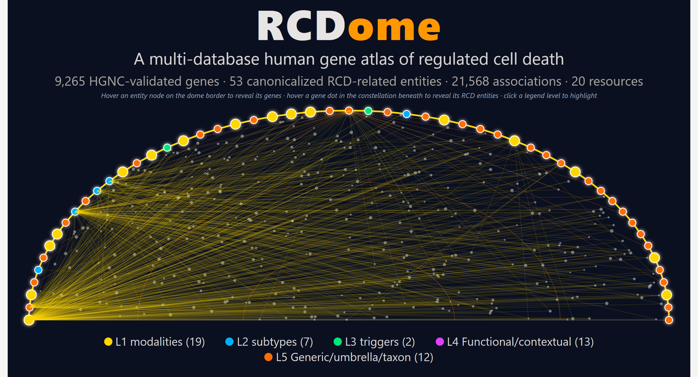
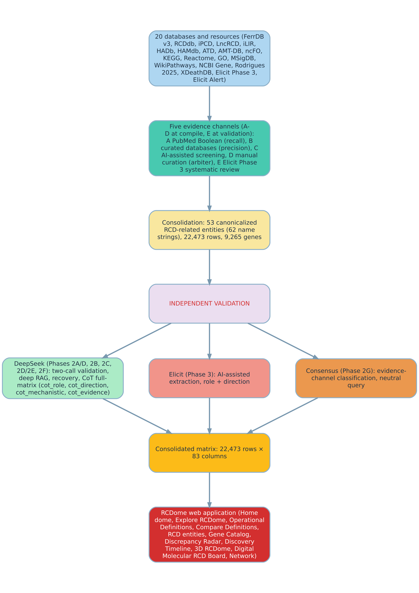

# 🧬 RCDome

**A multi-database human gene atlas of regulated cell death**

<p align="center">
  
  <br>
  <sub>RCD ontology dome: the cupola rim carries the 53 entities colored by ontological level (L1–L5) over a constellation of 9,265 genes — interactive in the live app (3D RCDome module)</sub>
</p>

**RCDome** is a gene-centric, multi-source knowledge platform that compiles, normalizes and independently validates every human gene–regulated cell death (RCD) association against the published record — integrating 20 source databases and resources into a single, traceable atlas of 53 canonicalized RCD-related entities and 9,265 genes.

Every claim is verifiable: each association carries its source provenance, evidence tier, mechanistic classification, functional role, direction, and the verified publication (PMID) that supports it — or is explicitly marked by its mechanistic class — `DATABASE_ONLY` (no PMID), `INSUFFICIENT_DATA` (PMID but no mechanistic evidence), `LITERATURE_GAP`, `CONTEXT_GAP`, or `CO_OCCURRENCE`.

The **dome** is RCDome's visual signature. Its cupola rim carries the 53 canonicalized RCD-related entities as nodes colored by their adjudicated ontological level — L1 modalities (19, gold), L2 subtypes (7, blue), L3 triggers (2, green), L4 Functional/contextual (13, purple), and L5 Generic/umbrella/taxon (12, orange) — over a constellation of the 9,265 HGNC-validated genes. The color-coding makes the ontology's core claim visible at a glance: only **19 of the 53** entities are bona fide RCD modalities (L1); the remaining 34 are subtypes, triggers, contextual programs, or umbrella concepts, and their level color encodes that distinction.

---


> 🔒 **Private repository** — truth snapshot V027, not the definitive version; amended versions are pushed as results emerge. Made public at manuscript submission.

## 📊 Key numbers (truth matrix V027)

| | |
|---|---|
| Matrix | **22,473 rows × 83 columns** |
| Unique gene–RCD pairs | **21,568** (+ 905 multi-database corroboration rows) |
| HGNC-validated genes | **9,265** |
| Canonicalized RCD-related entities | **53** (from 62 original name strings) |
| Source databases and resources | **20** |
| Independent analyses | **3** — DeepSeek · Elicit · Consensus |
| Executors / regulators / markers / unresolved | 469 / 9,311 / 5 / 11,783 |
| Direction (promotes / protects) | 5,070 / 4,755 |
| PMID titles verified against PubMed | **10,141 / 10,141 (100%)** |

## 🧭 Conceptual framework

<p align="center">
  
</p>

The pipeline runs in one top-to-bottom workflow: **20 source databases and resources → five compilation channels (A recall · B precision · C AI screening · D manual curation · E Elicit Phase 3) → consolidation → three independent validations (DeepSeek, Elicit, Consensus) → the 83-column matrix → the RCDome web application.**

---

## 🗂 Repository map

| Folder | Purpose |
|---|---|
| `docs/manuscript` | The manuscript (governance V027) + the OD **M&M** and **Results** subsections |
| `docs/supplementary` | Supplementary information, tables, and variable dictionary |
| `docs/figures` | Figures 1–4 and Supplementary Figures S1–S3 (600-DPI TIFF + PNG) |
| `docs/traceability` | The traceability & governance contract |
| `docs/governance` | Medina's AI Governance Rules + the **RCDome Definition Governance** (invariance, provenance P0–P3, two-call) |
| `docs/decoder` | OD inventory, draft definitions, review guide, sync tracking |
| `data/` | The truth matrix (`unified_gene_rcd_matrix_V027.csv`) + 10,141 verified PMID titles + the **53-entity decoder** (`RCDome_Decoder_53*`), review worksheet, merge log, NCCD-verbatim JSON, and validation artifacts |
| `code/extraction` | Source-database extraction (channels A, B, E) |
| `code/validation` | Phase 2A/D, DeepSeek CoT, and Consensus validation |
| `code/decoder` | OD definition pipeline (build, S scoring, audits, merge, full-text RAG validation) |
| `code/benchmarks` | Agnostic benchmark scripts (v1–v11 + Consensus v1–v7) |
| `code/merge` | Matrix merge/consolidation scripts |
| `code/figures` | Figure generators (reproduce every figure) |
| `app/` | The RCDome Shiny application |
| `results/changelogs` | Version changelog |

Every copied file is listed in [`mirror_manifest.txt`](mirror_manifest.txt) with its **SHA-256 hash** — the full copy is integrity-checkable.

---

## 🧬 RCDome Decoder — 53 operational definitions

Every canonicalized RCD-related entity carries an **operational definition (OD)** built in a
three-tier hierarchy — **NCCD 2018 verbatim** ([Galluzzi et al. 2018, *Cell Death Differ* 25(3):486–541, PMID 29362479](https://pubmed.ncbi.nlm.nih.gov/29362479/), invariant) →
**Rodrigues et al. 2025 verbatim** ([Rodrigues de Souza et al. 2025, *Front Bioinform* 5:1630518, our prior study](https://doi.org/10.3389/fbinf.2025.1630518)) →
**RCDome-drafted** (from the
founding article) — and scored by the six-criterion Rodrigues rubric with overall
score **S = 0.25·RS1 + 0.25·RS2 + 0.20·RS3 + 0.15·RS4 + 0.10·RS5 + 0.05·RS6** (verified
25/25 against the multi-optosis anchors, 53/53 bitwise).

| Layer | File |
|---|---|
| Entity records | `data/RCDome_Decoder_53.csv` / `.xlsx` (+ `_FINAL`) |
| Two-call review | `data/definition_review_worksheet.csv` / `.xlsx` (336 fields) + `data/merge_log.csv` |
| Governance | `docs/governance/RCDome_Definition_Governance.md` (invariance · provenance P0–P3 · two-call) |
| Methods / Results | `docs/manuscript/MandM_operational_definitions.md` + `Results_OD_census.md` |
| Validation | DeepSeek full-text RAG (`data/od_validation_deepseek_fulltext.csv`) · Consensus API (`data/od_crossref_consensus.csv`) · Europe PMC recovery · PubMed Knock Test (52/52) |
| Verbatim source | `data/galluzzi2018_nccd_definitions.json` (NCCD 2018 Box 1, byte-identical) |

The decoder is **fully audited** (final readiness audit 26/26; verbatim audit 20/20
NCCD + 25/25 Rodrigues; S formula 25/25) and every entity is **PMID-anchored** with a
full provenance chain (source databases → channels → reference PMID → author).

**References.**
1. [Galluzzi L., Vitale I., Aaronson S. A., Abrams J. M., Adam D., Agostinis P., et al. (2018). Molecular mechanisms of cell death: recommendations of the Nomenclature Committee on Cell Death 2018. Cell Death Differ 25(3): 486-541.](https://pubmed.ncbi.nlm.nih.gov/29362479/)
2. [Rodrigues de Souza E., Almeida Cordeiro Nogueira H., da Silva Francisco Junior R., Garcia A. B. and Medina-Acosta E. (2025). Integrated multi-optosis model for pan-cancer candidate biomarker and therapy target discovery. Front Bioinform 5: 1630518.](https://doi.org/10.3389/fbinf.2025.1630518)
3. [Rodrigues de Souza E., Almeida Cordeiro Nogueira H., Lopes V. d. S. and Medina-Acosta E. (2026). A pan-cancer multi-omic SuperLearner for regulated cell death survival topologies. Frontiers in Artificial Intelligence 9.](https://doi.org/10.3389/frai.2026.1895164)

---

## 🚀 Run the app locally

```r
setwd("/path/to/RCDome/app")
shiny::runApp(appDir = ".", port = 8890, launch.browser = TRUE)
```

The app loads `data/unified_gene_rcd_matrix_V027.csv` (place a copy in `app/data/`, or point `global.R` to it).

---

## 🔁 Reproducibility

1. **Secrets** — the Shiny app reads `.Renviron` (`DEEPSEEK_API_KEY`, `SMTP_USER`, `SMTP_PASS`); the code-level API keys are templated in `.env.example` (`NCBI_KEY`, `DEEPSEEK_KEY`, `ELICIT_API_KEY`, `CONSENSUS_API_KEY`). **Keys are never committed.**
2. **Execution order** — sources → channels (`code/extraction`) → Phase 2A/D & CoT & Consensus (`code/validation`) → merge (`code/merge`) → benchmarks (`code/benchmarks`) → figures (`code/figures`).
3. **Benchmarks** — the benchmark families are agnostic (fixed ground-truth sets defined independently of the classifiers): DeepSeek model-selection (26 pairs), Elicit governance (784 records), Consensus query (26 pairs), PMID title validation (10,141 titles), and the Digital Molecular RCD Board & Q&A regression suite (five checks, n = 100 each).
4. **Smoke tests** —  contains automated checks (run by GitHub Actions on every push) that verify the mechanistic classification mapping, the chain-of-thought governance rules, and the benchmark scoring.

## 🏆 Benchmarks (headline)

| Analysis | Result |
|---|---|
| DeepSeek chain-of-thought (26-pair) | **100% accuracy · 0% false positives** |
| Consensus neutral query (26-pair) | **100% accuracy · 0% false positives** |
| Elicit post-export governance | 5/5 gates passed (allow-list 75.4→100% · unsupported EXECUTOR rate 53→0% · traceability 24→98%) |
| PMID title validation | **10,141/10,141 (100%; 95% CI 99.96–100%)** |
| Digital Molecular RCD Board & Q&A — 5 regression checks (n = 100 each): reference discipline, context fidelity, English-only, minimal source, insufficient-data | **100% each (95% CI 96.4–100%)** |

---

## 🧾 Governance & traceability

This project follows **Medina's AI Governance Rules in Writing Scientific Manuscripts** (see `docs/governance`): AI assists without replacing the human; every number is verified against the matrix; no placeholders, no make-believe. The full **traceability & governance contract** (versioning, synchronization, forbidden actions) is in `docs/traceability`.

## ⏳ Honest status

| Item | Status |
|---|---|
| Matrix V027 | ✅ complete |
| Manuscript, figures, supplementaries | ✅ complete (V027) |
| DeepSeek CoT (full matrix) | ✅ complete (21,568 pairs) |
| Elicit (Phase 3) | ✅ complete |
| **Consensus full run** | ✅ complete (21,568 / 21,568 pairs) |
| App modules | ✅ complete (Home dome, Explore RCDome, Operational Definitions, Compare Definitions, RCD entities, Gene Catalog, Discrepancy Radar, Discovery Timeline, 3D RCDome, Digital Molecular RCD Board + Q&A, Network, About) |

## 📄 How to cite

Manuscript: *RCDome: a multi-database human gene atlas of regulated cell death.* Emanuell Rodrigues de Souza, Victor dos Santos Lopes, Higor Almeida Cordeiro Nogueira, Enrique Medina-Acosta.

## 👥 Authors

- Emanuell Rodrigues de Souza
- Victor dos Santos Lopes
- Higor Almeida Cordeiro Nogueira
- **Enrique Medina-Acosta** — [quique@uenf.br](mailto:quique@uenf.br)

## 📜 License

Code: **MIT** (`LICENSE`). Data and figures: **CC-BY-4.0** (attribution required).

## 🐞 Bug reports & contact

Open an issue, or contact **Enrique Medina-Acosta** — [quique@uenf.br](mailto:quique@uenf.br)
